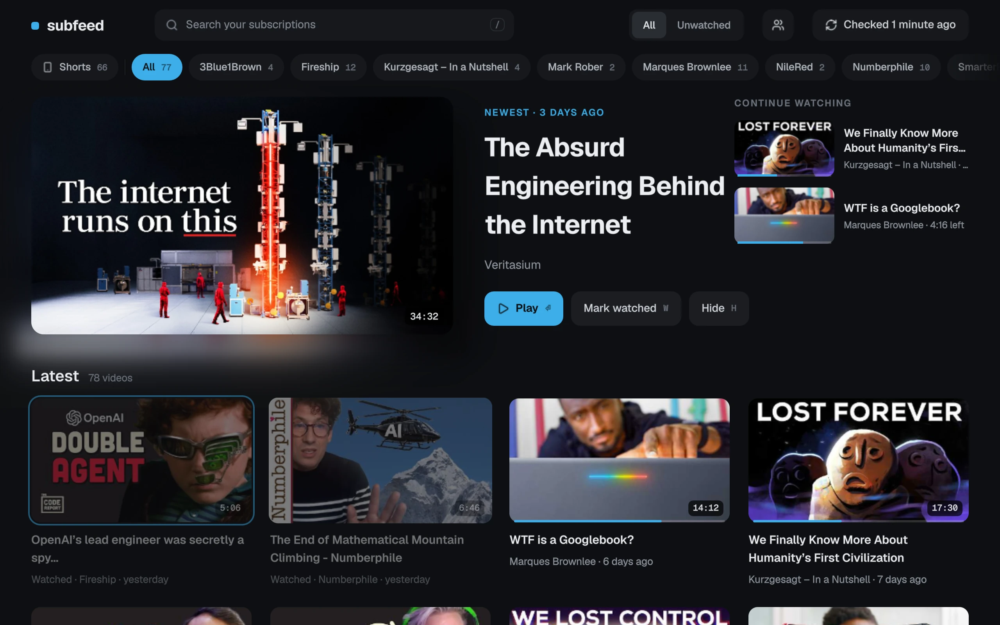
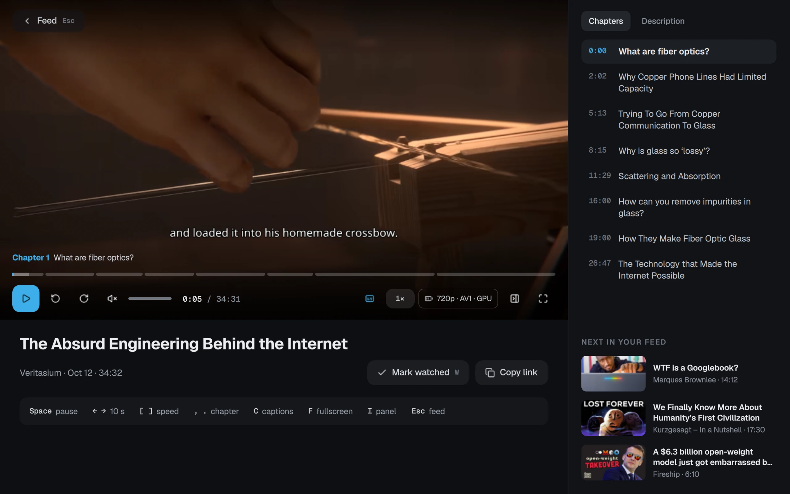
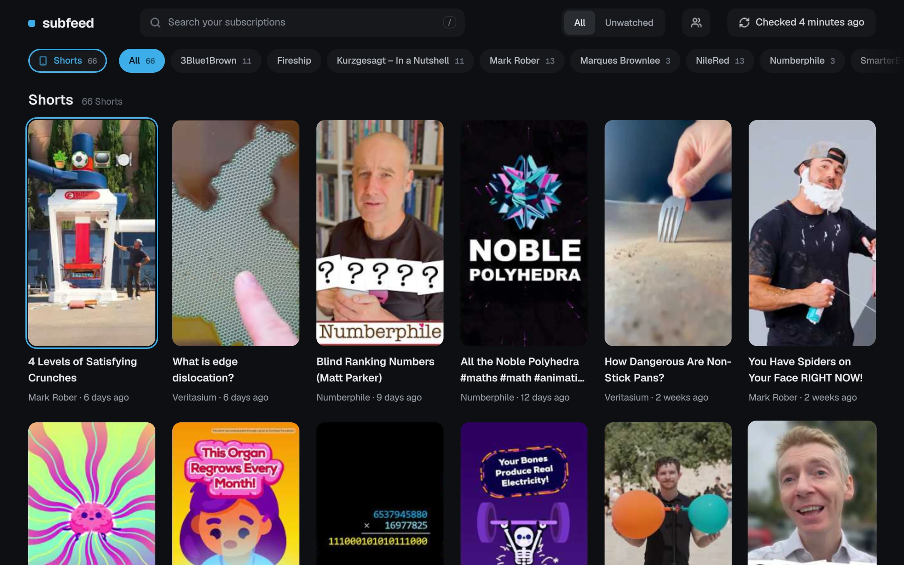
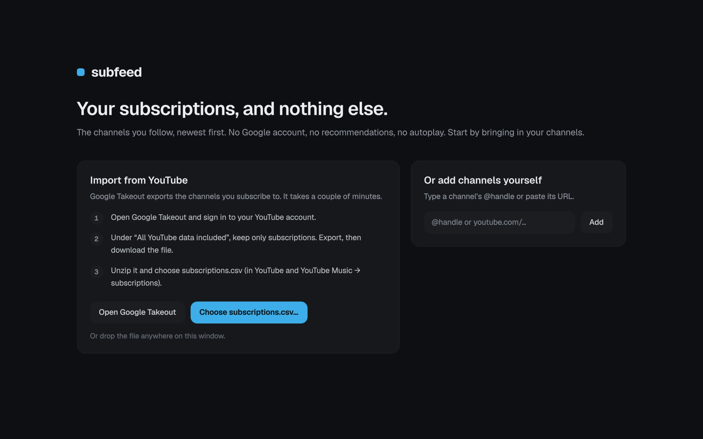
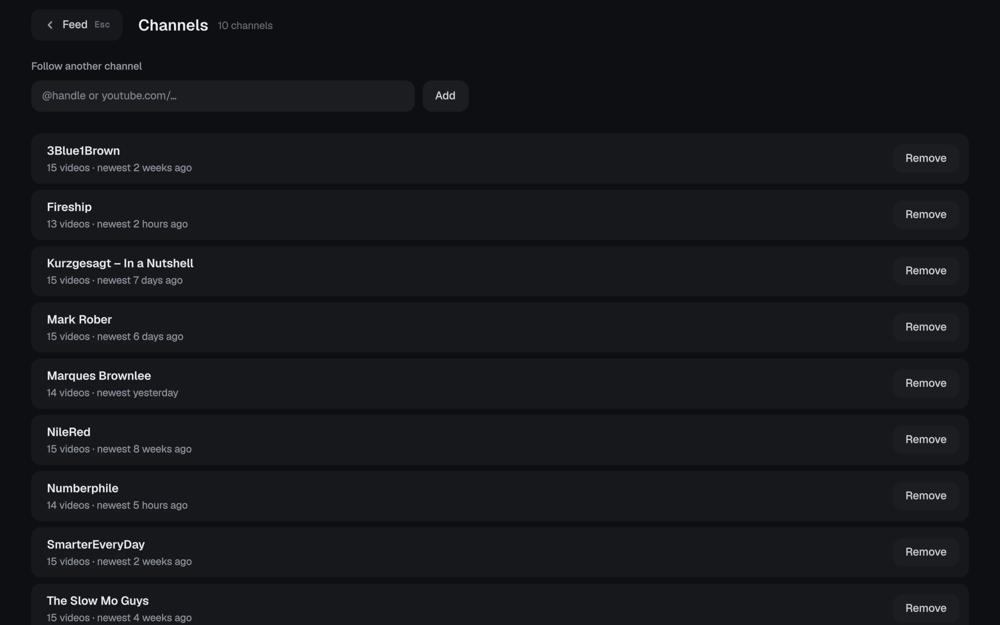
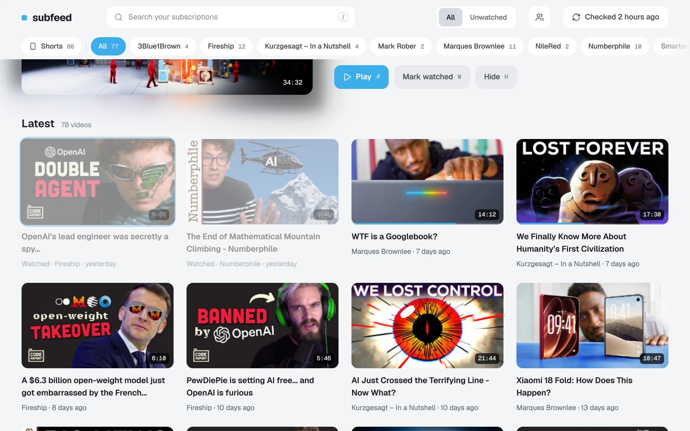

# subfeed

A distraction-free YouTube subscription player for the Linux desktop: the channels you follow,
newest first, played in a quiet, keyboard-first player. No Google account, no recommendations,
no autoplay, and Shorts kept in a view of their own. See [PLAN.md](PLAN.md) for the design and roadmap.



| | |
|---|---|
|  |  |
| **The player:** chapters, captions, resume, and quality that follows your power state. | **Shorts:** in their own view (`S`), never in the feed. |
|  |  |
| **First run:** import your subscriptions from Google Takeout, or add channels by name. | **Channels** (`M`): follow more, or remove one. |
|  | |
| **Light or dark:** follows your desktop; the player stays dark. | |

<sub>Screenshots use a demo set of public channels.</sub>

## What it does
- **Your subscriptions, newest first.** From YouTube's public feeds: no Google account, no recommendations. Refreshes in the background, with a notification when something new arrives.
- **A quiet, keyboard-first player:** chapters, captions (`C`), resume, and sponsor segments skipped through [SponsorBlock](https://sponsor.ajay.app) (looked up privately). Hardware decoding, with quality that drops to save battery.
- **Shorts** in a view of their own (`S`), never mixed into the feed.
- **Notes** (`N`): a video's transcript as a Markdown note, timestamped and split by chapter; ready for Obsidian.
- **Private:** subscriptions and history stay in a local database.
- **Keeps working:** when yt-dlp falls behind YouTube, subfeed says so (and the Flatpak updates its own).

## Install
- **Flatpak (any distribution):** download `subfeed.flatpak` from the [latest release](https://github.com/ekelly95/subfeed/releases/latest), then
  `flatpak install --user subfeed.flatpak` (it pulls the KDE runtime from Flathub if you don't have it).
  This build keeps its own yt-dlp current; for a new version of subfeed, install the newer file the same way.
  To build it yourself, see [`packaging/flatpak`](packaging/flatpak).
- **Arch Linux:** a PKGBUILD is in [`packaging/aur`](packaging/aur): `cd packaging/aur && makepkg -si`.
- **From source:** below.

## Build
```sh
cmake -S . -B build -G Ninja -DCMAKE_BUILD_TYPE=RelWithDebInfo
cmake --build build
./build/subfeed            # run
./build/subfeed --smoke    # open, wait for the player to initialise, quit (exit 0 = OK)
(cd rust && cargo test)
cmake --install build --prefix ~/.local   # binary, .desktop file and icon
```

Dependencies:
- Qt ≥ 6.8 (Core, Gui, Qml, Quick, QuickControls2, DBus), Kirigami (KF6)
- [MpvQt](https://invent.kde.org/libraries/mpvqt) and libmpv; libva (VA-API)
- Rust (stable) with [Corrosion](https://github.com/corrosion-rs/corrosion); CMake, Ninja, pkg-config, extra-cmake-modules
- At runtime: [yt-dlp](https://github.com/yt-dlp/yt-dlp) (kept up to date) and a JavaScript runtime it supports (Deno or Node)

Arch Linux: `pacman -S qt6-base qt6-declarative kirigami mpvqt mpv libva corrosion extra-cmake-modules cmake ninja yt-dlp yt-dlp-ejs deno` plus a Rust toolchain.
The first configure fetches `cxx-qt-cmake` (tag 0.10.0) from GitHub.

## Use
On first run the app offers to import your subscriptions from Google Takeout (YouTube and YouTube Music → subscriptions) or to add channels by name. The same from the command line:
```sh
./build/subfeed --import ~/Downloads/Takeout/YouTube*/subscriptions/subscriptions.csv
./build/subfeed --add @handle https://www.youtube.com/@other
./build/subfeed --refresh            # --force ignores backoff, --no-fallback skips yt-dlp
./build/subfeed --list 20
./build/subfeed --channels
./build/subfeed --open <video-id>    # start playing a video
./build/subfeed --shorts             # start in the Shorts view (S toggles it in the app)
./build/subfeed --manage             # start on the Channels page (M in the app)
./build/subfeed --notes <video-id> ~/Notes   # save a video's transcript as a Markdown note (N in the player)
./build/subfeed --install-timer      # check for new videos every 30 minutes in the background
                                     # (a systemd user timer; in the Flatpak, the Background portal)
```
Data lives in `$XDG_DATA_HOME/subfeed/subfeed.db` (override with `SUBFEED_DB`), thumbnails in `$XDG_CACHE_HOME/subfeed`.

## Logs
Some desktops send Qt logs to the journal. To see them in the terminal:
`QT_FORCE_STDERR_LOGGING=1 QT_LOGGING_RULES="js.debug=true" ./build/subfeed`

## How it was made
subfeed was written largely with Claude (Anthropic's AI model) through Claude Code, directed,
reviewed and tested by its author, who uses it daily.

## License
GPL-3.0-or-later (see [LICENSE](LICENSE)).
Bundled: [Geist](https://github.com/vercel/geist-font) fonts (SIL OFL 1.1, `fonts/OFL.txt`) and [Lucide](https://lucide.dev) icons (ISC, `icons/LICENSE`).

subfeed is not affiliated with YouTube or Google. It plays public videos through yt-dlp, for personal use.
